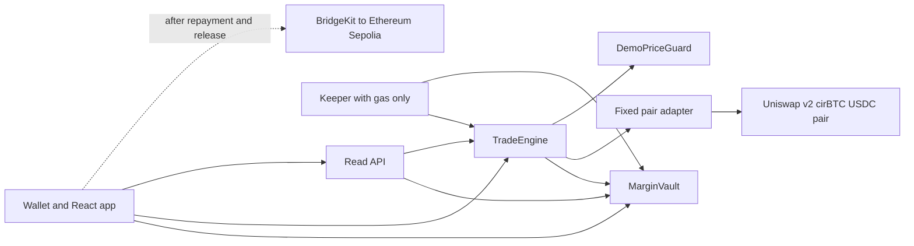

# Sacred Arc hackathon build specification

Deadline: **November 7, 2026 at 9:30 AM IST (09:30; 04:00 UTC)**. Target submission: **7:30 AM IST**. **Review candidate v0.2 — implementation is waiting for Claude Fable review and incorporation of fixes.**

## 0. Review before implementation

Order: **Codex specification → Claude Fable review → Codex revisions → implementation in Arc Studio**. Do not run the numbered build prompts yet. Send this specification, PLANS.md and COMMIT_PLAN.md to Claude Fable with CLAUDE_REVIEW_PROMPT.md. Return its findings here; Codex will record accepted/deferred/rejected findings with reasons, update this specification and every affected prompt, then freeze the revised specification hash in REVIEW_STATUS.json. Implementation starts only when that file says READY_FOR_IMPLEMENTATION and matches this specification. No Fable review has been run yet.

Keep one focused review pass: 30–45 minutes for review and 30–45 minutes for integration, unless a material correctness issue remains. Focus on accounting, security, feasibility, missing interfaces and scope cuts. Preserve the submission buffer rather than adding features.

The organisers' attached slides recommend adding plan files to the repository, explaining AI use, using many small commits, and understanding the implementation. They specify no mandatory filename. PLANS.md indexes the plan, specification, prompts and review decisions; AI_WORKLOG.md distinguishes observed human direction from agent contributions. Record actual decisions and checks without claiming generated text was human-written.

Implementation commits are sequential, one coherent behavior plus its tests. A prompt milestone normally produces several commits. Follow COMMIT_PLAN.md: inspect the diff, run relevant checks, commit that checkpoint, then proceed. Aim for roughly 50–300 handwritten changed lines; split larger work at real behavior boundaries. Never create a 1,000-plus-line catch-all commit. Separate dependency/generated changes, and surface an unavoidable oversized generated artifact rather than slicing it into invalid pieces. Preserve Studio authorship/history even when exporting each checkpoint for Git commits.

## 1. Build decision

Build **one working cirBTC financing market on Arc Testnet**, authored, tested and deployed in **one persistent Arc Studio project**. Deliver Earn, Trade and Activity, a small real API, and a keeper. Use an upstream Uniswap v2 pool for purchases and collateral sales. Add cirBTC bridging only after the core demo passes.

Implementation priorities: **complete the financing lifecycle → verify accounting and custody → connect real spot execution → optionally release and transfer repaid assets across chains**. Identity namespaces are deferred because they are not required for this financing workflow.

**Preserve from Sacred:** actual purchase before resale; 2× exposure; fixed 14-day sale; 10% annualized markup on financed principal; principal-first recovery; 77/23 split of collected markup; 160% coverage trigger and 190% restoration; limited recourse; withdrawal priority. The current repository contracts implement an older design and must not become the specification. [Current mechanism](https://sacred.markets/docs/trade/mechanism), [economics](https://sacred.markets/docs/earn/economics), [existing code status](https://sacred.markets/docs/contracts).

**Explicit pilot simplifications:** one asset, one funding cohort, nontransferable internal shares, at most 32 live positions and 64 live withdrawal requests; no Borrow, SCR token, full SIFT, higher leverage, vintages, upgrades, embedded wallets or mandatory profit share. Deposits close permanently before trading starts. Remaining shareholders receive subsequently realized LP earnings; redeemed shares relinquish future earnings. Queued shares remain exposed until filled. These accounting choices fill gaps in the public design and keep this build small.

Use the existing visual identity, public copy and design as references. Write fresh implementation in Studio. README must distinguish pre-existing design/site/assets from new hackathon code. Keep reuse and new implementation work clearly documented.

## 2. Arc Studio workflow and visibility

Use **Vite + React + TypeScript and Foundry**, matching Studio's documented scaffold. After the review gate clears, keep one project. Each prompt contains small sequential checkpoints: implement one, inspect its diff, test and commit it, then continue within the milestone. Do not rebuild the frontend on every prompt. Preserve the Studio project URL, deployment records and traces. The official CLI can drive the same server-side Studio agent from Codex; the web project should still appear in the demo. [Circle introduction](https://www.arc.io/blog/introducing-arc-studio-the-onchain-coding-agent), [official CLI](https://www.npmjs.com/package/@circle-fin/arc-studio-cli).

- Documented CLI prompt limit: **10,000 characters**. Attach this full specification using `--file`; use the numbered prompts for milestones. CLI reference limits: 100 files, 1 MB each, 10 MB total.
- Usage visibility: daily and rolling 30-day allowances, potentially user and organization scope. `arc-studio usage --json` reports percentage, window and scope; it does not publish absolute dollar/token/request quotas.
- A one-time organization usage increase lasting a month exists; price and increase size were not verified for this account. Inspect Settings → Plan if necessary.
- **Exact model identities remain undisclosed.** Terms permit one or more third-party models and changes. Neither a usage percentage nor a trace establishes the served model. [Terms](https://studio.arc.io/terms-of-use).
- The screenshot's **Eco Sauce** chip selects an integration skill, not a model. Remove it unless intentionally using that integration.
- Check usage before and after each milestone; reserve roughly one-third for fixes and deployment. This is a planning allowance, not a vendor quota. Do not assume a midnight IST reset.

Optional CLI setup and first implementation run, only after the review gate clears. Version checked during this research:

```sh
npm install -g @circle-fin/arc-studio-cli@1.2.2
arc-studio login
arc-studio usage --json
arc-studio agent-guide
arc-studio run --prompt-file ./00-preflight.txt --file ./spec.md --file ./PLANS.md --file ./COMMIT_PLAN.md --file ./REVIEW_STATUS.json --output json
arc-studio pull --changed --dry-run --diff
arc-studio deployments --json
arc-studio open
```

Use `agent-guide` for current continuation syntax and keep later runs in the same project. The browser alternative is to paste the numbered prompts in order, retaining the same project. Keep secrets in the platform's secret store, outside prompts and client code. No account-specific usage query, login or generation was performed for this specification.

## 3. Preflight and deployment configuration

Within **90 minutes**, establish the supported API hosting path, acquire official test tokens, compile the mixed Solidity versions, and demonstrate a real Uniswap buy and sell. Record results in `PREFLIGHT.md`. Scale position size to actual available liquidity rather than assuming a faucet allocation.

```text
network: Arc Testnet
chainId: 5042002
rpc: https://rpc.testnet.arc.io
explorer: https://explorer.testnet.arc.io
USDC ERC20: 0x3600000000000000000000000000000000000000
USDC ERC20 decimals: 6
native gas USDC decimals: 18
cirBTC: 0xf0C4a4CE82A5746AbAAd9425360Ab04fbBA432BF
cirBTC decimals: 8
term: 1209600 seconds
annualMarkupBps: 1000
lpMarkupBps: 7700
triggerBps: 16000
restoreBps: 19000
maxExecutionFrictionBps: 100  (proposed demo bound, includes AMM fee/impact)
maxOracleAge: 60 seconds
maxLivePositions: 32
```

Verify chain ID, bytecode and token decimals before enabling transactions. Native USDC and ERC20 USDC expose the **same balance**; never add them. Reserve wallet gas. Measure settlement using contract balance deltas; a user's USDC balance also pays gas. [Arc network](https://docs.arc.io/arc/references/connect-to-arc), [addresses](https://docs.arc.io/arc/references/contract-addresses), [USDC precision](https://www.arc.io/blog/building-with-usdc-on-arc-one-token-two-interfaces).

Published pilot references are $500/account, $25,000 financing ceiling and $250 financing dust. For the standard demo use contribution/financing of $500, so a partial sale can leave more than $250 principal. If faucet liquidity requires small positions, deploy a **visibly labeled small-value demo configuration**, with financing ceiling sized to funding and dust lowered explicitly, for example $1. Record every override in the manifest and UI. Do not silently apply the $250 dust rule to a $10 position and expect a partial sale. [SIFT pilot](https://sacred.markets/docs/trade/sift).

Keep 14-day economics in the main deployment. Demonstrate maturity using Foundry time-warp tests. A separate short-term live instance is optional and must display its actual immutable duration and resulting markup.

### Real swap integration

Pin unmodified upstream **Uniswap v2 core**, preserving licenses/version. Deploy factory and one USDC/cirBTC pair in Studio, seed it, and record token ordering, reserves and transaction hashes. Upstream core uses Solidity 0.5.16; compile it separately from new 0.8.x contracts using pinned build configuration. New contracts use a narrow fixed-pair adapter with canonical 997/1000 fee math, actual pair `swap`, exact input, min output and deadlines. No arbitrary target/calldata or native ETH/WETH route. Test both token orderings. [Upstream factory](https://github.com/Uniswap/v2-core/blob/master/contracts/UniswapV2Factory.sol).

Describe this accurately as **self-deployed upstream Uniswap v2 on Arc Testnet**. Official Arc mainnet deployments and API support do not establish testnet availability. [Uniswap deployments](https://developers.uniswap.org/docs/protocols/v4/deployments), [API networks](https://developers.uniswap.org/docs/trading/swapping-api/supported-chains).

If this fails its 90-minute gate, stop pursuing Uniswap. Implement only then an inventory-funded `TestInventoryVenue` behind the same interface: real official test tokens move atomically at an explicit demo quote. Preserve the financing demo and document the actual execution venue. Never present a fake swap receipt as an integration.

### Oracle choice

Use a clearly labeled, admin-controlled **DemoPriceGuard** on testnet, returning price in micro-USDC per whole cirBTC plus timestamp. Enforce positive price and age ≤60 seconds. Production-shaped interface allows a future independent oracle; production oracle selection is outside this build. Sacred proposes two independent sources, which this fixture does not provide. [Architecture](https://sacred.markets/docs/architecture).

For the liquidation demonstration, move the actual seeded AMM price with a real scenario swap, then update the demo reference price consistently. Lowering only the displayed feed is insufficient. The ordinary keeper cannot change prices. Display “testnet scenario price” beside coverage.

## 4. Smart contract specification

Use two main contracts plus narrow adapters. Freeze policy parameters and dependency addresses at deployment. Guardian may pause funding/originations; repayment, claims and debt-free release remain available. No proxy, collateral rescue, arbitrary call or unrestricted manager withdrawal.

### MarginVault

Own USDC, internal nontransferable shares, queue and segregated protection balances. Expose `deposit`, `closeFunding`, `requestWithdraw`, `processWithdrawals(maxRequests)`, `claim`, `vaultState` and engine-only accounting methods. Funding closes once, before the first trade. Every deposit accepts the fixed 77/23 mandate hash.

Track separately: depositor idle cash, outstanding principal, manager cash, primary reserve, tail reserve, pilot backstop and claimable withdrawals. Direct donations do not change recorded NAV or mint shares. Cash reserved for claims, reserves, manager or trader is never lendable.

After required loss resolution:

```text
LP_NAV = depositorIdleCash + outstandingPrincipal
```

Exclude uncollected markup and pledged assets from NAV. Principal is already represented by its receivable. Initial funding shares mint 1:1 in micro-USDC units. Realized LP markup increases share value; uncovered principal losses reduce it. No late subscriptions.

Before every withdrawal cash reservation, including immediate redemption, or manager distribution, scan the bounded live positions using fresh conservative net collateral values. If any value is below its remaining principal, revert `AccountingNeedsSettlement(id)` until that eligible position is closed and its loss recorded. Stale prices block those reservations and distributions; wallet repayment, debt-free release and claims of already-reserved cash still work. Never apply this gate to claim(). This bounded settlement gate is the pilot's impairment treatment.

Origination requires: no unfilled withdrawal queue; temporary gross purchase cash available; net depositor idle cash after opening ≥5% of NAV; outstanding principal plus commitments ≤95% of NAV and the configured pilot financing ceiling; per-account cap respected. Reserve commitments before external calls. Primary and tail targets must each be funded: **0.4% and 0.6% of the immutable approved financing ceiling**, respectively. Seed these with separately identified test treasury contributions. This fixes the target basis for the pilot; never take targets from depositor principal. [Earn rules](https://sacred.markets/docs/earn).

For the demo, essential operational expense is zero. Route the manager's collected share first to replenish primary, then tail, then retain the excess as locked manager cash. Defer company cash targets and distributions. Final losses draw primary → tail → separate pilot backstop → LP NAV. Record gross economic shortfall even when reserves absorb it.

**FIFO withdrawals:** requests lock shares; locked shares remain in supply until filled. One global queue; no cancel/reinsert shortcut. Always process the oldest unfilled request first, including partial fills. An idle request may be filled immediately through this same processor. Carry the head and unfilled shares across daily UTC epoch boundaries; incoming repayment may continue funding the current head, without resetting priority. Bound each call to 16 requests. New finance stays blocked while any request remains unfilled.

At each fill, compute `burnShares = min(headUnfilledShares, floor(depositorIdleCash * totalShares / LP_NAV))` and `payout = floor(burnShares * LP_NAV / totalShares)`. Require positive NAV, burnShares and payout; recompute after every fill. Burn those shares, move payout from depositor idle to claimable, then advance only when the head is complete. Claims are pull transfers and do not reduce NAV again. Reject zero-share and zero-value fills. Bound live requests and require positive available shares. Display queue status and claimable cash independently.

### TradeEngine

Expose `previewOpen`, `open`, `repay`, `repayAndRelease`, owner `close`, permissionless `rebalance`, permissionless `settleMatured`, `getPosition`, and bounded active IDs. Position fields: trader, cost, original/remaining principal, original/remaining markup, collateral quantity, timestamps, cumulative markup allocations, status and terms hash. Debt and position ownership are nontransferable in this pilot.

**Opening sequence, one atomic transaction:**

1. For trader contribution `E`, gross cost `C=2E`, financed principal `P=E`. Validate policy, feed, route, slippage, contribution allowance and commitments. Enforce an onchain acquisition floor: `expectedAtoms=floor(C*10^8/priceMicroUSDC)` and `oracleMinOut=floor(expectedAtoms*(10000-maxExecutionFrictionBps)/10000)`. Require nonzero output, use the stricter of this floor and trader minOut, and require initial coverage at least 190%.
2. The vault must have **C cash**, not merely P. Buy actual cirBTC using vault cash and verify quantity received into vault custody or its narrowly authorized purchasing agent.
3. Record acquisition before resale. Transfer the acquired asset into engine pledge custody; record the disclosed sale and trader beneficial ownership. Collect E from the trader into the vault. Any failure reverts the entire transaction.
4. Net vault cash falls P; outstanding principal rises P. Emit acquisition, sale and pledge events with quantities and terms. A receipt token alone is not asset acquisition.

```text
M = floor(P * 1000 * termSeconds / (10000 * 365 days))
D = P + M
maturity = openedAt + termSeconds
```

Use full-precision integer arithmetic. Fix markup once; no late growth, compounding, rollover or trader-profit share. Pilot early rebate is zero and disclosed in the accepted terms. All amounts are integer token units.

**Cash waterfall:** for actual receipt `S`, pay `p=min(P,S)`, then `m=min(M,S-p)`, then return `S-p-m` to trader. Update principal and markup once. Ordinary partial repayment keeps remaining collateral pledged and does not create a loss. Full repayment releases all collateral even if the oracle is stale.

Allocate markup cumulatively per position: `LP allocation = floor(totalMarkupCollected*7700/10000) - previousLPAllocation`; manager receives the rest of this payment. Never split principal or trader surplus. This prevents repayment-fragment rounding gains.

**Owner close / maturity:** sell remaining collateral through the actual venue with guarded min output; apply actual USDC proceeds. On final closure, gross principal shortfall is remaining principal not recovered by the sale. Draw segregated reserves in order, write off the residual principal and all unpaid markup, clear debt, return surplus and mark closed. No external recourse. Repeated settlement must fail. `settleMatured` is callable only after immutable maturity.

### Coverage and partial sale

```text
V = floor(collateralAtoms * priceMicroUSDC / 10^8)
D = remainingPrincipal + remainingMarkup
eligible if V*10000 <= D*16000
target after partial sale: V_after*10000 >= D_after*19000
```

With target `R=1.9` and execution-friction bound `f=0.01`, gross oracle value to sell is `g=(R*D-V)/(R*(1-f)-1)`. Compute the equivalent integer formula and round collateral input **up**. The adapter enforces actual output ≥ the oracle value sold ×(1−f), plus any stricter user bound. Deadlines are mandatory. The engine determines the permitted quantity; a keeper cannot choose an arbitrary oversized liquidation.

Apply actual proceeds principal first and verify actual post-sale coverage. Quantity rounding tolerance is at most one collateral atom's oracle value plus one micro-USDC, documented in tests. If the required quantity exhausts collateral, the target is infeasible, or remaining principal would be below configured dust, close fully. Debt zero also closes/releases. Slippage or stale-price failure leaves state unchanged and retryable. Keepers pay gas from their own gas-funded wallet; no fee from depositor principal.

### Exact acceptance vectors

- E=500 USDC → C=1,000, P=500; 14-day M=**1.917808**, D=**501.917808**. Fully collected markup allocates LP **1.476712**, manager **0.441096**.
- At V=803.0684928, coverage is 160%. Ignoring friction, sell value **167.305936** to reach exactly 190%. The deployed calculation must include its friction bound, token rounding and actual output.
- Final close P=500, M=1.917808, actual proceeds=480: gross principal loss20; markup0. Primary4, tail6, backstop5 cover15; LP loses5. Gross loss remains20 in events.
- FIFO: A deposits300, B200; P50 opening leaves450 idle. A requests300 shares and fills first. B requests200;150 fill,50 stay queued. New finance is blocked. Repayment returns50 principal plus the realized LP markup to the remaining shares; claims must not debit NAV a second time. Use small-value demo dust for this fixture.

## 5. Frontend and backend



**Frontend:** reuse Sacred's visual identity, with three tabs and a persistent Arc Testnet badge. No redesign of the marketing site.

- **Earn:** funding-open/closed state, connected balance, accepted mandate, shares and current value, realized earnings, protection balances; deposit, request withdrawal, queue position and claim.
- **Trade:** one asset; contribution, fixed 2×, real acquisition quote, P/M/D, maturity, coverage levels, execution bound and approval/open buttons. Position actions: repay amount, repay and receive cirBTC, sell and close. Display actual remaining full debt and reference-price timestamp.
- **Activity:** real acquisition/sale/pledge/payment/split/queue/reserve/loss events, hashes, explorer links, deployment addresses and compact architecture. Show pending, confirmed, reverted and retry states; never show success before a successful receipt.
- Use bigint/decimal strings for transactions, explicit 6/8/18 decimals, wallet-chain checks, actionable errors and double-submit guards. Refresh after receipts. Keep gas available. Failed backend requests must be visible.

**Backend:** one small Node/TypeScript service using viem, generated in Studio. Endpoints: `GET /health`, `/config`, `/vault`, `/positions?owner=`, `/activity?cursor=`. Amounts are integer strings; include observed block and timestamp. `/config` returns manifest, policy hash, deployment block and feature flags. Contract reads are financial truth. A small persistent event cache is optional; key logs by chain, tx hash and log index, persist cursor, and rescan a confirmation overlap without duplicating events. Do not build a subgraph, user database, custody service or authentication system.

Preflight must prove the chosen host can serve this API to the deployed UI. Generate its hosting configuration in Studio. If Studio cannot host a persistent worker, keep the real API hosted through the supported deployment path and provide a user-triggered permissionless keeper button; show scheduling as unavailable. A static frontend with invented backend responses fails acceptance.

**Keeper:** one process polling bounded live IDs every 10–15 seconds. Simulate eligible rebalances/maturity settlement, submit, persist pending hash/nonce, await receipt and retry safely. Process eligible FIFO batches afterward. The key has gas only and no guardian, price or treasury powers. UI shows last successful poll and last error. Manual fallback invokes the same onchain functions. Feed scenario updates are a separate explicit test harness.

## 6. Optional Bridge Kit extension

Only begin after the core end-to-end flow passes. Use standalone `@circle-fin/bridge-kit` and its supported viem adapter, pinning versions after a real smoke test. Flow: **repay → receipt → release cirBTC → bridge → destination receipt**. These are separate transactions in one guided UI. Bridge failure must leave protocol repayment complete and tokens under user control.

Verified sandbox route: **Arc Testnet domain 26 → Ethereum Sepolia domain 0**. Official cirBTC token ID:

```text
0x7c27b7b6485f3ea49b7d1a439e288d3c3116f533302afabb7e372dfc0770cc7d
Sepolia cirBTC: 0x3a3fe695f684bf9b9e43cf43c2b895ea5e392bb3
```

Live Iris registry and a signed fee quote succeeded during research; no transfer was performed. A quoted 0.0001 cirBTC transfer had a 0.2 native-USDC protocol fee, excluding gas, for that short-lived quote. Fetch a fresh quote; never hardcode it. Base Sepolia was not enabled for this token. [Registry](https://iris-api-sandbox.circle.com/v2/cctpx/tokens?tokenid=0x7c27b7b6485f3ea49b7d1a439e288d3c3116f533302afabb7e372dfc0770cc7d), [SDK quickstart](https://docs.arc.io/app-kit/quickstarts/bridge-tokens-across-blockchains), [expanded assets](https://developers.circle.com/cctp/expanded-assets).

Require one real BridgeKit transfer, source receipt, attestation, destination receipt and increased destination balance before enabling the feature. Use whole-token decimal strings in the SDK. Standard finality without forwarding is the verified quote path; fund destination Sepolia ETH for self-mint. Persist bridge state by source transaction and wallet; resume attestation/mint instead of burning again. Show signature/source/attesting/destination/completed/recoverable-error states. Stop after a 60-minute unsuccessful rehearsal and leave this optional feature disabled.

## 7. Acceptance, demo and deadline

**Contract tests:** actual acquisition before sale; failed swap or contribution rolls back; fixed markup/no late growth; principal-first recovery and cumulative split; partial repay retains pledge; full repay releases despite stale feed; coverage includes markup; friction/rounding/dust handling and keeper cannot oversell; slippage failure preserves state; commitments/caps/idle floor; FIFO partial persistence across epochs; queue blocks new finance; claim accounting once; impairment before redemption; reserve order and gross-loss preservation; duplicate/unauthorized calls; reentrancy; token ordering and decimals; pause keeps exit payments available. Use fuzz/invariant tests for asset accounting, collateral conservation and no payout exceeding segregated balances.

**Real integration tests:** official token approvals/transfers, real Uniswap purchase and sale, two-wallet funding/trading, actual settlement receipts, API values reconciling to contracts, pending/revert/retry UI, queue funded from repayment. Test maturity with time warp. Bridge tests are separate and optional.

**Delivery gates, IST:** complete the Fable review and Codex revisions first, aiming for one 60–90-minute combined review cycle. After that gate: preflight within 90 minutes; contract core by **Nov 6, 8:00 PM**; working frontend/API and core rehearsal by **11:30 PM**; optional bridge only if that core gate is already green, with a **Nov 7, 12:30 AM** cutoff; freeze implementation then; video and submission package by **3:00 AM**; submit by **7:30 AM**, ahead of the **9:30 AM** deadline. Late gates cut optional scope; they do not move the submission deadline. These are planning targets, not measured build-time guarantees.

**Demo:** rehearse a core version of about three minutes inside the organisers’ **4-minute finalist demo slot**, followed by **3 minutes of Q&A**. A video and live deployment are required; confirm the upload-duration limit in the submission form rather than assuming the finalist slot is the video limit.

1. Show Studio project, generated contracts and passing tests; explain sale-based spot financing in one sentence.
2. Show funded Earn vault; open 2× cirBTC position. Follow the real purchase → fixed sale → pledge trace and explorer link.
3. Repay and release. Show exact fixed debt and collected 77/23 allocation.
4. Show a second prepared position's real price scenario and partial sale; coverage restores toward 190%. Show a queued withdrawal filling from returned liquidity. Prepared accounts are fine; transaction evidence must be real.
5. If rehearsed, show released cirBTC bridging to Sepolia. Close with architecture and repository.

**Submission files:** PLANS.md, AI_WORKLOG.md, actual review findings/dispositions, milestone prompts, and sequential Git history; README with setup, demo script, prior-work disclosure and integration documentation; Studio share URL accessible to judges; live app/API URLs; deployment manifest and explorer links; architecture diagram; test results; short video and minimal presentation; project-page descriptions and screenshots; source repository with licenses. For Uniswap add `FEEDBACK.md`, submit the [developer feedback form](https://developers.uniswap.org/hackathon-feedback), and link exact integration files/lines in README. Use the selected event track's requirements.

Success means the complete core flow runs with real testnet transactions, tests pass, backend is reachable, and a fresh reviewer can reproduce the demo. Keep proposed sale-based financing and testnet status visible; current Sacred design still has open review questions. [Sacred status](https://sacred.markets/docs), [review questions](https://sacred.markets/docs/shariah).
