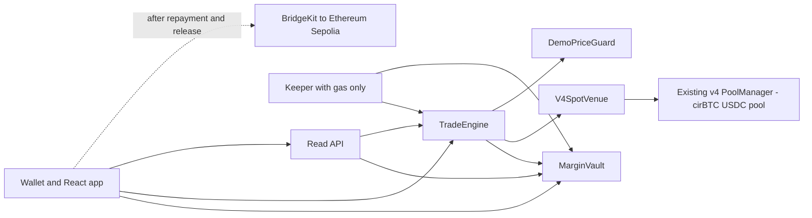

# Sacred Arc hackathon build specification

Deadline: **November 7, 2026 at 9:30 AM IST (09:30; 04:00 UTC)**. Target submission: **7:30 AM IST**. **Revised v0.3 — Fable review incorporated; ready for implementation preflight.**

## 0. Review and execution

The requested sequence is complete through specification revision: Codex specification → Claude Fable review → Codex assessment and fixes. REVIEW_DECISIONS.md records every finding and the mathematical corrections to the review. REVIEW_STATUS.json pins this specification. Ready for implementation means the design review is complete; live liquidity, hosting and deployment checks still belong to preflight.

The organisers recommend plan files and explaining AI use. PLANS.md indexes the current plan; AI_WORKLOG.md records actual contributions. Code generation, tests and deployment happen in one Arc Studio app. Codex pulls each completed checkpoint, reviews it, runs relevant checks and creates a small local Git commit before the next checkpoint. COMMIT_PLAN.md owns this local workflow; Studio is asked to implement one checkpoint per turn, not manage Git history.

## 1. Build decision

Build **one working cirBTC financing market on Arc Testnet**, authored, tested and deployed in **one persistent Arc Studio project**. Deliver Earn, Trade and Activity, a small real API, and a keeper. Use the existing Uniswap v4 deployment and a seeded USDC/cirBTC pool for purchases and collateral sales. Add cirBTC bridging only after the core demo passes.

Implementation priorities: **complete the financing lifecycle → verify accounting and custody → connect real spot execution → optionally release and transfer repaid assets across chains**. Identity namespaces are deferred because they are not required for this financing workflow.

**Preserve from Sacred:** actual purchase before resale; 2× exposure; fixed 14-day sale; 10% annualized markup on financed principal; principal-first recovery; 77/23 split of collected markup; 160% coverage trigger and 190% restoration; limited recourse; withdrawal priority. The current repository contracts implement an older design and must not become the specification. [Current mechanism](https://sacred.markets/docs/trade/mechanism), [economics](https://sacred.markets/docs/earn/economics), [existing code status](https://sacred.markets/docs/contracts).

**Explicit pilot simplifications:** one asset, NAV-priced deposits, nontransferable internal shares, at most 32 live positions and 64 live withdrawal requests; no Borrow, SCR token, full SIFT, higher leverage, vintages, upgrades, embedded wallets or mandatory profit share. Deposits are allowed while the withdrawal queue is empty, after the impairment check. Uncollected markup is excluded from NAV: new depositors share future collections pro rata; redeemed shares relinquish them. Disclose this simplified allocation in deposit terms. Queued shares remain exposed until filled. These accounting choices fill gaps in the public design and keep this build small.

Use the existing visual identity, public copy and design as references. Write fresh implementation in Studio. README must distinguish pre-existing design/site/assets from new hackathon code. Keep reuse and new implementation work clearly documented.

### Repository

Implementation repository: **https://github.com/smitrajput/sacred-markets**, local `/Users/smitrajput/Projects/halal-defi/sacred-markets`. The existing `sacred` repository remains the prior website/design repository. Preserve both histories.

Layout: `contracts/` (Foundry), `src/` (Vite React TypeScript), `api/` (read service + keeper + Dockerfile), `docs/spec.md`, `docs/prompts/`, `docs/review/`, `docs/COMMIT_PLAN.md`, `docs/ARCHITECTURE.md`; root `PLANS.md`, `AI_WORKLOG.md`, `README.md`, `FEEDBACK.md`, `LICENSE`. The manifest is `deployments/arc-testnet.json`. New app code is generated in Studio; these planning documents are maintained locally.

## 2. Arc Studio workflow and visibility

Use **Vite + React + TypeScript and Foundry**, matching Studio's scaffold. Build in the browser's existing app/thread; select the **Uniswap skill** and remove Eco Sauce. Paste the relevant self-contained prompt as text with no attachment. Send only its selected checkpoint, then stop for local review. Keep the full spec in the repository for local review; the browser rejected a prompt bundled with that large attachment. Keep the Studio share URL and trace for each checkpoint. [Studio overview](https://docs.arc.io/ai/arc-studio).

- Prompt cap: **10,000 characters**. Each browser message is self-contained and checked in UTF-16 units below8,500 characters. Do not attach the37k-character spec. CLI --file is a separate documented input mechanism and remains unverified for this account.
- `arc-studio usage --json` exposes usage percentages, windows and scope. Absolute quotas and served model identities remain undisclosed. Reserve roughly one-third of the observed allowance for fixes; this is our planning allowance, not a vendor quota.
- **Git ownership:** Studio generates one change → `arc-studio pull --app "$SACRED_APP_ID" --out "$SACRED_REPO"` → Codex inspects/tests → commits named files/hunks → pushes to GitHub. See STUDIO_GIT_WORKFLOW.md for executable commands. First pull is full; later pulls may use `--changed` if every turn has been captured. A full dry-run catches generated files and missed turns.
- Pull skips local edits with exit code 2. Reconcile the specific file; preserve the local copy. Never automate `--force`. Keep plans/docs locally owned and ask Studio to leave them alone.
- Studio's web GitHub export is optional; branch/hunk/commit-message controls are unverified. It is not our canonical Git workflow. A CLI pull alone never creates or pushes a commit.
- CLI `run --app` retains files but opens a new thread. Continue the browser thread for context, or use a named CLI session with the latest spec attached. Read current `agent-guide` before CLI orchestration. [CLI reference](https://docs.arc.io/ai/arc-studio-cli).

Secrets stay in host secret stores, outside prompts, frontend bundles and commits. Local Codex skills are not automatically installed in Studio: the prompt pack carries their relevant requirements, and Studio uses its own available Uniswap skill.

## 3. Preflight and deployment configuration

Within **60 minutes of starting Studio**, verify the existing v4 contracts, token funding, two-way execution and hosting. Record results in `docs/PREFLIGHT.md`. An unavailable faucet allocation is a sizing constraint: reduce the demo amounts before adding infrastructure. Do not self-deploy another AMM.

```text
network: Arc Testnet
chainId: 5042002
rpc: https://rpc.testnet.arc.io
explorer: https://explorer.testnet.arc.io
USDC ERC20: 0x3600000000000000000000000000000000000000
USDC ERC20 decimals: 6
native gas USDC decimals: 18
cirBTC: 0xf0C4a4CE82A5746AbAAd9425360Ab04fbBA432BF
cirBTC decimals: 8
term: 1209600 seconds
annualMarkupBps: 1000
lpMarkupBps: 7700
triggerBps: 16000
restoreBps: 19000
maxExecutionFrictionBps: 300  (total bound includes fee, price impact and reference deviation)
maxOracleAge: 86400 seconds (explicit testnet fixture, with refresh runbook)
maxLivePositions: 32
```

Verify chain ID, bytecode and token decimals before enabling transactions. Native USDC and ERC20 USDC expose the **same balance**; never add them. Reserve wallet gas. Use only ERC20 `balanceOf` for protocol USDC accounting, never `address(this).balance` or `msg.value`. Measure settlement using contract balance deltas; a user's USDC balance also pays gas. Omit SELFDESTRUCT and native-value routes. Set transaction `maxFeePerGas` to at least 20 gwei and dynamically high enough for the current base fee; never confuse gwei with micro-USDC. [Arc EVM differences](https://docs.arc.io/arc/references/evm-differences). [Arc network](https://docs.arc.io/arc/references/connect-to-arc), [addresses](https://docs.arc.io/arc/references/contract-addresses), [USDC precision](https://www.arc.io/blog/building-with-usdc-on-arc-one-token-two-interfaces).

Published policy references are $500/account, $25,000 financing ceiling and $250 dust. Those are **unit-test scale**, not the live faucet budget. The deployment manifest must name all role addresses, balances, policy overrides, pool key/ID, seed amounts, ticks, initial sqrtPriceX96, token decimals, deployment block, transaction hashes and code provenance.

**Demo sizing:** preferred E=10 USDC, C=20, P=10; ceiling=100, per-account cap=10, dust=1, friction=300 bps. Scale these four monetary parameters together if needed; first fallback E=0.10, ceiling=1, cap=0.10, dust=0.01. Keep whole-token atom precision meaningful. Compute seed and gas requirements from available balances before deployment. The app displays the actual immutable configuration.

A full-range 0.3% pool needs reserve/trade ≥ `(0.997 × (1−f))/(f−0.003)`: **141.0043× at 1%**, **35.8182× at 3%**. Thus a 20-USDC buy still needs about **716.37 USDC per side** at 3%, before safety margin. A 0.20-USDC buy needs about **7.17 USDC per side**; target ≥10 per side and prove the scenario on a fork. Vault funding, treasury protection, trader contributions and gas are additional to pool liquidity. Narrow ranges are deferred: they can run out of liquidity during the required price move.

Preflight must quote and execute buy, normal close and the prepared coverage sale at the final scale. Include input fees, atom rounding and price deviation in the same 300-bps budget. The initial 190% test stays in force: at 14 days and 10% markup, maximum mathematical friction is about 463.56 bps; the implementation caps configurable friction at **460 bps**, with 300 for the demo. A larger slippage allowance is not a liquidity substitute.

Keep 14-day economics in the main deployment. Demonstrate maturity using Foundry time-warp tests. A separate short-term live instance is optional and must display its actual immutable duration and resulting markup.

### Real swap integration

Use the existing v4 PoolManager on **chain 5042002**; do not deploy v2. On Nov 6, block 71009777, read-only checks confirmed code at all six addresses below, matching `poolManager()` getters on the periphery and nonzero liquidity in the USDC/EURC 500-fee pool. The proposed cirBTC 3000-fee pool was uninitialized. Save this evidence; preflight still needs a real swap and source/runtime identity verification. The public Uniswap table labels these addresses **Arc mainnet (5042)**, so code presence alone is not a testnet provenance claim. [Deployment table](https://developers.uniswap.org/docs/protocols/v4/deployments).

```text
PoolManager: 0x8366a39CC670B4001A1121B8F6A443A643e40951
PositionManager: 0x6049c9a0e26405C0985f9E3685C87d0aE917f82B
V4Quoter: 0x8Dc178eFB8111BB0973Dd9d722ebeFF267c98F94
StateView: 0xF3334192D15450CdD385c8B70e03f9A6bD9E673b
UniversalRouter: 0x4fcA4a51Ab4F23A7447b3284fBd7D73289A89Fb1
Permit2: 0x000000000022D473030F116dDEE9F6B43aC78BA3
PoolKey: currency0=USDC, currency1=cirBTC, fee=3000, tickSpacing=60, hooks=0
poolId: 0xf4e18ec272549ab0140d43d33a7ba93768ecaec4dee4a7fb4f2c9af00950cde4
```

Pin upstream v4 core/periphery dependencies and compatible Solidity/EVM configuration. Initialize and seed a full-range position through PositionManager; align ticks to spacing. Use token atoms when calculating sqrtPriceX96 (token1 atoms/token0 atoms), not human-unit prices. Preserve upstream licenses. Universal Router is not needed by the financing adapter.

`V4SpotVenue` implements a narrowly scoped `IUnlockCallback`: fixed immutable pool key/PoolManager/authorized engine; exact-input swaps in both directions; callback callable only by that PoolManager during an active operation; derive direction from the fixed currencies; settle negative input delta with `sync → transfer → settle`, `take` positive output delta to the authorized receiver; validate complete input consumption, minOut, deadline and zero outstanding deltas. Restrict callback data to the pending operation and expected amounts. No arbitrary payer, recipient, pool or calldata. Measure actual balance deltas. Use Quoter through read-only simulation for frontend quotes. Inventory venues belong only in unit tests.

### Reference-price fixture

Keep **DemoPriceGuard**, separate from the trading pool. Positive micro-USDC price per whole cirBTC, timestamp not in the future, age ≤86,400 seconds; immutable max age and separate price-admin role. Pool spot can be manipulated within a transaction, so a guard band does not make it an independent liquidation oracle. StateView supplies venue diagnostics, not solvency truth.

Ship `scripts/push-price.ts` and `scripts/run-price-scenario.ts` in Studio. The designated operator refreshes the explicit demo reference before rehearsal/submission and at least daily while the demo remains live; document this in the handoff, and show expiry/maintenance state in the UI. The script reads back price, timestamp and receipt; no silent refresh from pool spot. The scenario harness first moves the real pool, then the operator deliberately updates the fixture to the prepared consistent value. Ordinary keepers have no pricing authority. Full repayment, debt-free release and reserved claims remain available after expiry. This is an admin-controlled testnet fixture, not Sacred's proposed two-source production oracle.

## 4. Smart contract specification

Use two main contracts plus narrow adapters. Freeze policy parameters and dependency addresses at deployment. Guardian may pause funding/originations; repayment, claims and debt-free release remain available. No proxy, collateral rescue, arbitrary call or unrestricted manager withdrawal.

### MarginVault

Own USDC, internal nontransferable shares, queue and segregated protection balances. Expose `deposit(amount,minShares,mandateHash)`, `requestWithdraw`, `processWithdrawals(maxRequests)`, `claim`, `burnWorthlessShares`, `seedProtection(kind,amount)`, `vaultState` and engine-only accounting methods. Every deposit accepts the fixed 77/23 mandate hash. Deposits are open whenever the queue is empty, funding is unpaused, and the impairment gate passes.

Track separately: depositor idle cash, outstanding principal, manager cash, primary reserve, tail reserve, pilot backstop and claimable withdrawals. Direct donations do not change recorded NAV or mint shares. Cash reserved for claims, reserves, manager or trader is never lendable.

After required loss resolution:

```text
LP_NAV = depositorIdleCash + outstandingPrincipal
```

Exclude uncollected markup and pledged assets from NAV. Principal is already represented by its receivable. With zero supply and no recorded LP assets or live positions, mint initial shares 1:1 in micro-USDC units. Otherwise require NAV>0 and mint `floor(amount*totalShares/NAV)` using pre-deposit NAV; require nonzero shares and caller minShares. Reject recapitalization into zero NAV with existing shares. Realized LP markup increases share value; uncovered principal losses reduce it. New deposits share later markup collections pro rata, as disclosed.

Before every deposit, withdrawal cash reservation (including immediate redemption), or manager distribution, scan the bounded live positions using fresh conservative net collateral values. If any value is below its remaining principal, revert `AccountingNeedsSettlement(id)` until that eligible position is closed and its loss recorded. Stale prices block those reservations and distributions; wallet repayment, debt-free release and claims of already-reserved cash still work. Never apply this gate to claim(). This bounded settlement gate is the pilot's impairment treatment.

Origination requires: no unfilled withdrawal queue; temporary gross purchase cash available; net depositor idle cash after opening ≥5% of NAV; outstanding principal plus commitments ≤95% of NAV and the configured pilot financing ceiling; per-account cap respected. Reserve commitments before external calls. Primary and tail targets must each be funded: **0.4% and 0.6% of the immutable approved financing ceiling**, respectively. A named treasury calls `seedProtection(kind,amount)` with kind primary/tail/backstop; transferFrom actual USDC and increment only that bucket, never shares/NAV. For ceiling100, targets are primary0.4/tail0.6 USDC; for ceiling1, primary0.004/tail0.006. Backstop is separately optional and recorded. This fixes the target basis for the pilot; never take targets from depositor principal. [Earn rules](https://sacred.markets/docs/earn).

For the demo, essential operational expense is zero. Route the manager's collected share first to replenish primary, then tail, then retain the excess as locked manager cash. Defer company cash targets and distributions. Final losses draw primary → tail → separate pilot backstop → LP NAV. Record gross economic shortfall even when reserves absorb it.

**FIFO withdrawals:** requests lock shares; locked shares remain in supply until filled. One global queue; no cancel/reinsert shortcut. Always process the oldest unfilled request first, including partial fills. An idle request may be filled immediately through this same processor. This is a continuous queue without epochs; incoming repayment funds the current head without resetting priority. Bound each call to 16 requests. New finance stays blocked while any request remains unfilled.

At each fill with positive NAV, compute `burnShares = min(headUnfilledShares, floor(depositorIdleCash * totalShares / LP_NAV))` and `payout = floor(burnShares * LP_NAV / totalShares)`. Recompute after each fill; reserve payout, burn shares and advance only when the head is complete. Claims are pull transfers and never debit NAV twice.

**Rounding and total loss:** requests explicitly consent to write-off of an entire residual request worth less than one micro-USDC. After the impairment check, if NAV=0 or `floor(headUnfilledShares*NAV/totalShares)==0`, burn that entire queued residual for zero, emit `WithdrawalDustWrittenOff`, and advance (bounded by maxRequests). Do this before checking idle=0. Otherwise idle=0, burnShares=0 or a *partial* payout=0 means return without mutation, awaiting liquidity; do not destroy shares whose complete request has redeemable value. Zero-NAV holders can burn their own unlocked worthless shares; new initial funding requires supply=0 and no live positions. Test these separately: legitimate waiting is not queue corruption. Bound requests and require positive available shares; display claimable cash independently.

**Last-share guard:** while any position remains live, totalShares must stay at least one, including during dust/zero-NAV burns. Cap a regular fill at `totalShares−1` and recompute its payout; if zero shares can burn, wait for settlement. Apply the same guard to worthless-share burns. This prevents a principal-only repayment followed by the last LP exit from orphaning later markup collections. Once all positions are closed, the final share can redeem/burn normally. Test P=0/M>0 followed by a full withdrawal request, final markup payment and final claim.

### TradeEngine

Expose `open`, `repay`, `repayAndRelease`, owner `close`, permissionless `rebalance`, permissionless `settleMatured`, `getPosition`, and bounded active IDs. Position fields: trader, cost, original/remaining principal, original/remaining markup, collateral quantity, timestamps, cumulative markup allocations, status and terms hash. Debt and position ownership are nontransferable in this pilot.

**Opening sequence, one atomic transaction:**

1. For trader contribution `E`, gross cost `C=2E`, financed principal `P=E`. Validate policy, feed, route, slippage, contribution allowance and commitments. Enforce an onchain acquisition floor: `expectedAtoms=floor(C*10^8/priceMicroUSDC)` and `oracleMinOut=floor(expectedAtoms*(10000-maxExecutionFrictionBps)/10000)`. Require nonzero output, use the stricter of this floor and trader minOut, and require initial coverage at least 190%.
2. The vault must have **C cash**, not merely P. Buy actual cirBTC using vault cash and verify quantity received into vault custody or its narrowly authorized purchasing agent.
3. Record acquisition before resale. Transfer the acquired asset into engine pledge custody; record the disclosed sale and trader beneficial ownership. Collect E from the trader into the vault. Any failure reverts the entire transaction.
4. Net vault cash falls P; outstanding principal rises P. Emit acquisition, sale and pledge events with quantities and terms. A receipt token alone is not asset acquisition.

```text
M = floor(P * 1000 * termSeconds / (10000 * 365 days))
D = P + M
maturity = openedAt + termSeconds
```

Use full-precision integer arithmetic. Fix markup once; no late growth, compounding, rollover or trader-profit share. Pilot early rebate is zero and disclosed in the accepted terms. All amounts are integer token units.

**Repayment callers:** the trader or any payer may repay on the trader’s behalf. Pull funds only from msg.sender; collateral and surplus always return to the recorded trader. `repayAndRelease` requires full remaining debt. Owner `close` means position trader, not protocol admin.

**Cash waterfall:** for actual receipt `S`, pay `p=min(P,S)`, then `m=min(M,S-p)`, then return `S-p-m` to trader. Update principal and markup once. Ordinary partial repayment keeps remaining collateral pledged and does not create a loss. Full repayment releases all collateral even if the oracle is stale.

Allocate markup cumulatively per position: `LP allocation = floor(totalMarkupCollected*7700/10000) - previousLPAllocation`; manager receives the rest of this payment. Never split principal or trader surplus. This prevents repayment-fragment rounding gains.

**Owner close / maturity:** sell remaining collateral through the actual venue with guarded min output; apply actual USDC proceeds. On final closure, gross principal shortfall is remaining principal not recovered by the sale. Draw segregated reserves in order, write off the residual principal and all unpaid markup, clear debt, return surplus and mark closed. No external recourse. Repeated settlement must fail. `settleMatured` is callable only after immutable maturity.

### Coverage and partial sale

```text
V = floor(collateralAtoms * priceMicroUSDC / 10^8)
D = remainingPrincipal + remainingMarkup
eligible if V*10000 <= D*16000
target after partial sale: V_after*10000 >= D_after*19000
```

With R=1.9 and total friction f=0.03, gross reference value to sell is `g=(R*D−V)/(R*(1−f)−1)`. Integer implementation, with `B=10000`, `Rb=19000`, `fb=300`:

```text
denominator = Rb*(B-fb) - B*B
gMicroUSDC = ceil((Rb*D - B*V)*B / denominator)
sellAtoms = ceil(gMicroUSDC*10^8 / priceMicroUSDC)
```

Use full-precision mulDiv rounding up and a positive denominator. The extra numerator `*B` is essential. For zero debt release; for ineligible coverage reject before subtracting. Enforce actual output ≥ reference value of the rounded atoms ×(1−f), and any stricter user bound. Capture the independent reference once per operation. The engine selects quantity; a keeper cannot choose an oversized sale.

Partial sale needs both `g < V` and worst-case remaining principal `P−(1−f)*g >= dust`. For P500/dust250/f1%, the approximate feasible trigger band is **145.6751%–160%**; for P10/dust1/f3%, **112.0824%–160%**, before atom rounding. The latter lower bound is not 103%: that ignores financing dust. Use 155% for the live scenario. Below the feasible band, or when input exhausts collateral, close fully using actual proceeds. If actual execution would violate dust despite the conservative estimate, revert the partial path and retry a full close; never finalize a below-dust partial position.

Apply actual proceeds principal first and verify actual post-sale coverage ≥190% against the captured reference. Document an atom-rounding tolerance bounded by one collateral atom's reference value plus one micro-USDC. Slippage/expired feed failures leave state unchanged. Ordinary keepers pay gas from a limited operational wallet; no fee from depositor principal.

Prepare scenario-wallet cirBTC from measured full-range pool reserves: an approximately 25% price drop needs roughly 15.5% of the cirBTC reserve sold (before fee correction). Derive the exact size from a fork rehearsal with current reserves; also reserve cirBTC for the position itself. One scenario transaction moves the pool and a second operator transaction sets the consistent demo fixture.

### Exact acceptance vectors

- Policy-scale fixture: E=500 USDC → C=1,000, P=500; 14-day M=**1.917808**, D=**501.917808**. Fully collected markup allocates LP **1.476712**, manager **0.441096**.
- At V=803.0684928, coverage is 160%. Ignoring friction, sell value **167.305936** to reach exactly 190%. The deployed calculation must include its friction bound, token rounding and actual output.
- Policy-scale reserve fixture with ceiling1,000: final close P=500, M=1.917808, actual proceeds=480: gross principal loss20; markup0. Primary4, tail6, backstop5 cover15; LP loses5. Gross loss remains20 in events.
- FIFO: A deposits300, B200; P50 opening leaves450 idle. A requests300 shares and fills first. B requests200;150 fill,50 stay queued. New finance is blocked. Repayment returns50 principal plus the realized LP markup to the remaining shares; claims must not debit NAV a second time. Use small-value demo dust for this fixture.

- Preferred demo: E10 → M0.038356, D10.038356; collected markup LP0.029534, manager0.008822. These are independent fixed expectations for tests, not UI hardcodes.
- Add live-deposit share pricing, zero-payout residual, partial-zero-payout wait, zero-NAV burn/reset, 155% partial sale and 140% policy-scale full-close cases.

## 5. Frontend and backend



**Frontend:** reuse Sacred's visual identity, with three tabs and a persistent Arc Testnet badge. No redesign of the marketing site.

- **Earn:** deposit availability and reason when blocked, connected balance, accepted mandate, shares and current value, realized earnings, protection balances; deposit, request withdrawal, queue position and claim.
- **Trade:** one asset; contribution, fixed 2×, real acquisition quote, P/M/D, maturity, coverage levels, execution bound and approval/open buttons. Position actions: repay amount, repay and receive cirBTC, sell and close. Display actual remaining full debt and reference-price timestamp.
- **Activity:** real acquisition/sale/pledge/payment/split/queue/reserve/loss events, hashes, explorer links, deployment addresses and compact architecture. Show pending, confirmed, reverted and retry states; never show success before a successful receipt.
- Use bigint/decimal strings for transactions, explicit 6/8/18 decimals, wallet-chain checks, actionable errors and double-submit guards. Refresh after receipts. Keep gas available. Failed backend requests must be visible.

**Backend:** a Node/TypeScript service using viem. `GET /health`, `/config`, `/vault`, `/positions?owner=`, `/activity?cursor=`; integer-string amounts, observed block/timestamp, manifest/policy hash. `/activity` uses bounded block ranges from deploymentBlock and an in-memory cache keyed by chain/txHash/logIndex. Paginate and cap reads, rescan a small overlap, and never rescan the entire lifetime on every request. Contract reads remain financial truth; no database/indexer/auth subsystem.

**Hosting decision:** frontend → Netlify; API + keeper → one Node process in a Hugging Face Docker Space, port7860 bound to0.0.0.0, with a mutex-guarded async polling loop. Verify account entitlement and deployment in preflight: current HF docs require a paid plan for new Docker Spaces, and free hardware can sleep. Do not assume paid access or unattended uptime. If unavailable, deploy the same read handlers as Netlify Functions and run the gas-funded keeper from the operator's machine for the demo; keep the permissionless wallet button as the durable fallback and display scheduler state honestly. This fallback adds no new hosting provider. [Studio capabilities](https://docs.arc.io/ai/arc-studio), [HF lifecycle and access](https://huggingface.co/docs/hub/spaces-overview).

**Keeper:** poll bounded live IDs every 10–15s while awake. Simulate eligible actions, send one transaction at a time, wait for a successful receipt, then process up to16 FIFO entries. `maxFeePerGas=max(20gwei, dynamically estimated safe fee)`; use a sensible priority fee and refresh estimates on retry. Never run overlapping async intervals. Pin one wallet to one worker; reconcile latest/pending nonce at startup and on timeout. If pending state cannot be reconciled after restart, report paused and use manual wallet execution rather than blindly resending. Persist pending metadata where durable storage is available; chain receipts and position state remain authoritative.

The keeper has gas only, no treasury/guardian/price powers. `/health` exposes last poll, last confirmed action, pending hash and error without secrets. There is no public endpoint accepting arbitrary transactions. Manual “Process eligible action” invokes the same permissionless contract method from the user's wallet. Netlify fallback API exposes scheduling as external/unavailable, not a simulated keeper.

**Skill-guided frontend:** build an operational financial interface: preserve Sacred's type/color identity, one primary action at each stage, readable amounts and coverage, keyboard focus, responsive layout, transaction-specific loaders and errors. Apply Impeccable's Operate guidance and ETHSkills frontend transaction sequence; Taste and Awesome DESIGN.md are reference material, not a mandate to replace the app with a marketing page. See SKILLS.md for installed sources. Render and inspect the actual app at desktop/mobile sizes; a TSX file is not a demo.

## 6. Optional Bridge Kit extension

Only begin after the core end-to-end flow passes. Use standalone `@circle-fin/bridge-kit` and its supported viem adapter, pinning versions after a real smoke test. Flow: **repay → receipt → release cirBTC → bridge → destination receipt**. These are separate transactions in one guided UI. Bridge failure must leave protocol repayment complete and tokens under user control.

Verified sandbox route: **Arc Testnet domain 26 → Ethereum Sepolia domain 0**. Official cirBTC token ID:

```text
0x7c27b7b6485f3ea49b7d1a439e288d3c3116f533302afabb7e372dfc0770cc7d
Sepolia cirBTC: 0x3a3fe695f684bf9b9e43cf43c2b895ea5e392bb3
```

Live Iris registry and a signed fee quote succeeded during research; no transfer was performed. A quoted 0.0001 cirBTC transfer had a 0.2 native-USDC protocol fee, excluding gas, for that short-lived quote. Fetch a fresh quote; never hardcode it. Base Sepolia was not enabled for this token. [Registry](https://iris-api-sandbox.circle.com/v2/cctpx/tokens?tokenid=0x7c27b7b6485f3ea49b7d1a439e288d3c3116f533302afabb7e372dfc0770cc7d), [SDK quickstart](https://docs.arc.io/app-kit/quickstarts/bridge-tokens-across-blockchains), [expanded assets](https://developers.circle.com/cctp/expanded-assets).

Require one real BridgeKit transfer, source receipt, attestation, destination receipt and increased destination balance before enabling the feature. Use whole-token decimal strings in the SDK. Standard finality without forwarding is the verified quote path; fund destination Sepolia ETH for self-mint. Persist bridge state by source transaction and wallet; resume attestation/mint instead of burning again. Show signature/source/attesting/destination/completed/recoverable-error states. Stop after a 60-minute unsuccessful rehearsal and leave this optional feature disabled.

## 7. Acceptance, demo and deadline

**Contract tests:** actual acquisition before sale; failed swap or contribution rolls back; fixed markup/no late growth; principal-first recovery and cumulative split; partial repay retains pledge; full repay releases despite stale feed; coverage includes markup; friction/rounding/dust handling and keeper cannot oversell; slippage failure preserves state; commitments/caps/idle floor; FIFO partial persistence across processing calls, zero-value residuals and total-loss handling; queue blocks new finance; claim accounting once; impairment before redemption; reserve order and gross-loss preservation; duplicate/unauthorized calls; reentrancy; token ordering and decimals; pause keeps exit payments available. Use fuzz/invariant tests for asset accounting, collateral conservation and no payout exceeding segregated balances.

**Real integration tests:** official token approvals/transfers, real Uniswap purchase and sale, two-wallet funding/trading, actual settlement receipts, API values reconciling to contracts, pending/revert/retry UI, queue funded from repayment. Test maturity with time warp. Bridge tests are separate and optional.

**Delivery gates, IST:** preflight within 60 minutes of starting Studio; contract core by **Nov 6 9:00 PM**; deployed frontend/API and core rehearsal by **Nov 7 12:30 AM**. Bridge only after a green core, and only if it finishes by **1:30 AM**. Freeze by **2:00 AM**; video by **4:00 AM**; submit by **7:30 AM**, ahead of the **9:30 AM** deadline. If core slips, drop bridge immediately and fix the core. These are cutoffs, not build-time guarantees.

**Demo:** rehearse a core version of about three minutes inside the organisers’ **4-minute finalist demo slot**, followed by **3 minutes of Q&A**. Use a live deployment and a video **≤4 minutes, without speed-up**, as reported by Fable from the current submission form. Check upload acceptance before the submission buffer.

1. Show Studio project, generated contracts and passing tests; explain sale-based spot financing in one sentence.
2. Show funded Earn vault; open 2× cirBTC position. Follow the real purchase → fixed sale → pledge trace and explorer link.
3. Let a second wallet deposit at current NAV; show that the live Earn flow remains available. Repay and release. Show exact fixed debt and collected 77/23 allocation.
4. Show a second prepared position at about155% coverage after a real scenario swap and explicit reference-fixture update; execute a partial sale; coverage restores toward 190%. Show a queued withdrawal filling from returned liquidity. Prepared accounts are fine; transaction evidence must be real.
5. If rehearsed, show released cirBTC bridging to Sepolia. Close with architecture and repository.

**Submission files:** PLANS.md, AI_WORKLOG.md, actual review findings/dispositions, milestone prompts, and sequential Git history; README with setup, demo script, prior-work disclosure and integration documentation; Studio share URL accessible to judges; live app/API URLs; deployment manifest and explorer links; architecture diagram; test results; short video and minimal presentation; project-page descriptions and screenshots; source repository with licenses. For Uniswap add `FEEDBACK.md`, submit the [developer feedback form](https://developers.uniswap.org/hackathon-feedback), and link exact integration files/lines in README. Use the selected event track's requirements.

Success means the complete core flow runs with real testnet transactions, tests pass, backend is reachable, and a fresh reviewer can reproduce the demo. Keep proposed sale-based financing and testnet status visible; current Sacred design still has open review questions. [Sacred status](https://sacred.markets/docs), [review questions](https://sacred.markets/docs/shariah).

## 8. Operational trust and callers

- Onchain: assets, shares, fixed sale terms, debt, queue, reserves and settlement. Offchain: presentation, quotes, read aggregation and transaction scheduling.
- Access: guardian can stop new deposits/originations; price admin can block price-dependent actions by failing to refresh the fixture. Repayment, debt-free release and reserved claims remain self-serve. Token issuer/network controls still apply.
- Inspectability: publish source and deployment evidence, preserve upstream licenses, and provide self-host/run commands. Public balances, positions and transactions are visible; RPC/host providers can observe request metadata.
- Funds: no upgrade proxy; keeper cannot move arbitrary funds; ordinary users retain wallet control. Admin-priced testnet collateral is the main pilot compromise; do not describe it as production price security.

| Transition | Caller and motivation | If nobody calls |
| --- | --- | --- |
| deposit / requestWithdraw / claim | depositor seeks exposure or exit | funds/shares remain in current state |
| open / close | trader seeks exposure or exit | no position opens / pledge remains |
| repay / repayAndRelease | trader or payer reduces fixed debt | debt stays fixed; pledge remains |
| rebalance / settleMatured | operator-funded keeper or participant protects/settles pool | eligible settlement waits; impairment gate can block new deposits/reservations |
| processWithdrawals | keeper or queued depositor wants liquidity assigned | queue retains priority; no fresh finance |
| seedProtection | treasury funds protection | new finance blocked until targets met |
| push demo price | designated price operator maintains test scenario | price-dependent actions expire; direct repayment/claims remain |

The implementation README must include this caller table and the actual deploy/verify/run commands, secret variable names, role destinations, refreshed-price instructions and small post-deployment transaction evidence.
